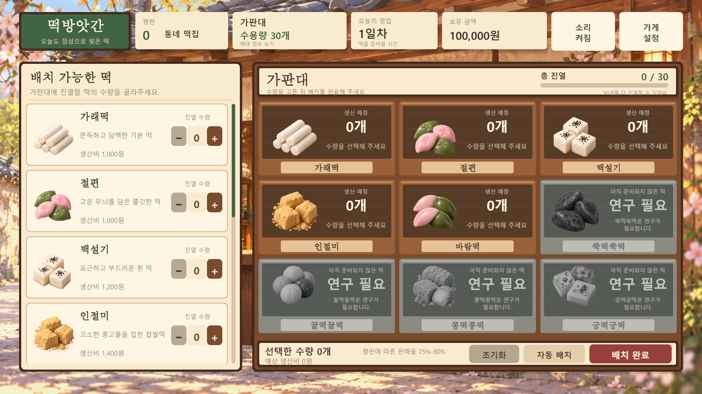
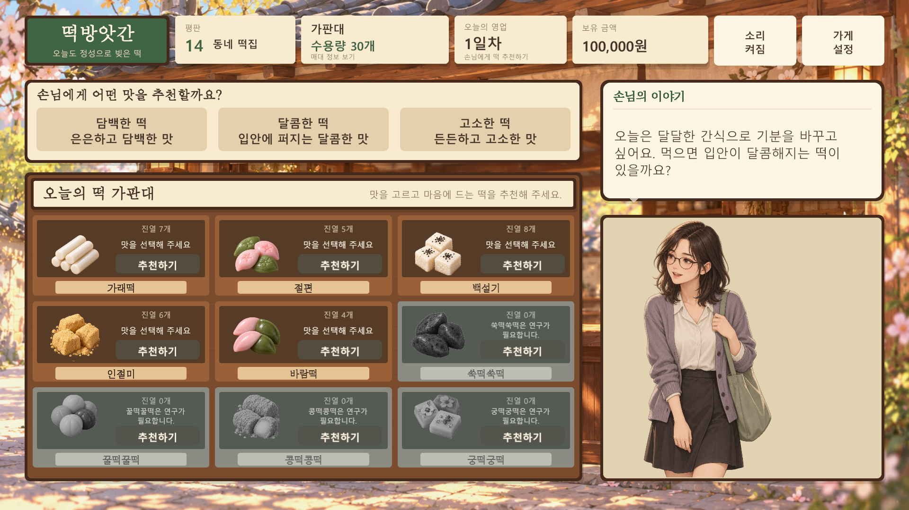
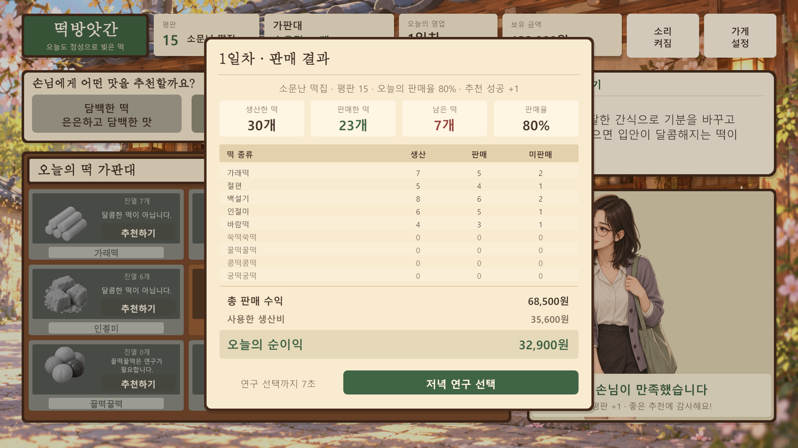
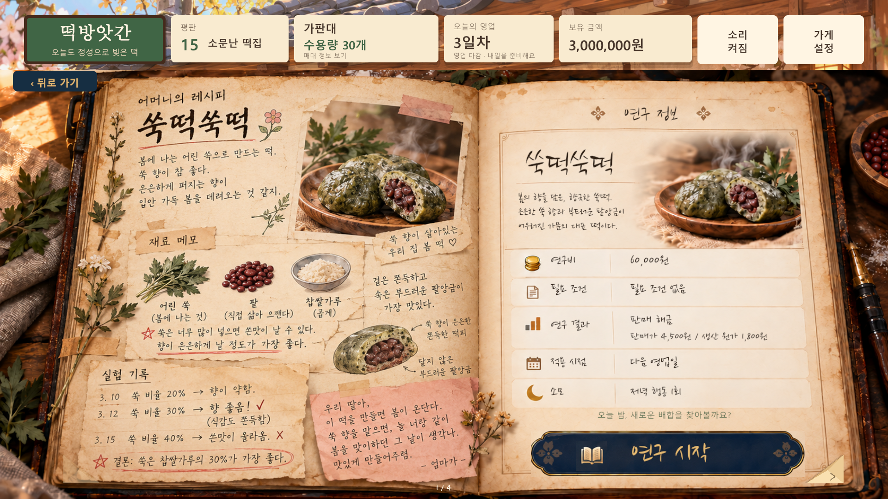
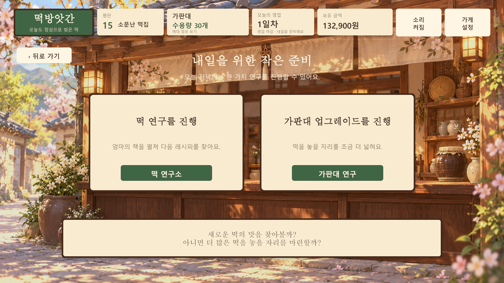

# 떡방앗간 · 생산 / 진열 / 판매 / 손님 추천 / 저녁 연구

기획서의 떡 종류, 가격, 생산비와 평판별 판매율에 매일 찾아오는 손님 추천과 저녁 연구를 연결한 Unity uGUI 프로젝트입니다. Unity 프로젝트 루트는 저장소 안의 `Game` 폴더입니다.



## 실행

1. Unity Hub에서 **Add → Add project from disk**를 선택합니다.
2. `C:\Users\ohseongjun\Documents\GitHub\DDUKDDUK\Game` 폴더를 추가합니다.
3. **Unity 6000.3.25f1**로 엽니다. uGUI 패키지는 **2.0.0**입니다.
4. `Assets/Shop/Scenes/RiceCakeShop.unity`를 열고 **Play**를 누릅니다.

1920 × 1080 기준 화면을 Canvas Scaler와 화면 맞춤 배율로 표시합니다. 왼쪽 목록을 스크롤하면 9종의 떡을 모두 볼 수 있습니다.

Unity를 열기 전에 화면만 확인하려면 `Game/Builds/ShopPreview/ShopPreview.exe`를 실행합니다. 이 Windows 실행 파일은 로컬 확인용이며 Git에 포함하지 않습니다.

## 하루 진행

**수량 선택 → 배치 완료 → 판매 시작 안내 → 손님 요구사항 → 맛 선택·떡 추천 → 만족 여부 → 리절트 → 저녁 연구 선택 → 다음 날 아침 → 떡 배치**

- `+ / −`로 수량을 선택합니다. `초기화`와 `자동 배치`도 사용할 수 있습니다.
- 최초 자금은 **100,000원**, 평판은 **0**, 가판대 한도는 모든 종류를 합해 **30개**입니다. 종류별 30개 재고를 주는 방식은 아닙니다.
- 상단 `가판대`에서는 현재 한도와 확장 조건을 확인합니다. 가판대 확장은 영업이 끝난 뒤 저녁 연구에서 신청하고 **다음 날** 적용합니다.
- `배치 완료` 때 선택한 수량과 생산비를 확정하고 바로 판매를 시작합니다. 확정 후에는 수량을 바꿀 수 없습니다. 판매 시작 시 판매 수량과 금액만 계산합니다. 배치·손님 등장·추천 피드백 동안 보유금은 유지하고, 추천이 끝난 뒤 **판매 결과창이 뜰 때 판매 수익 − 확정 생산비를 한 번 반영**합니다.
- 0개를 선택해도 생산·판매·다음 날 진행이 가능합니다. 추천할 떡이 없으면 `추천 없이 마치기`로 손님 응대를 마치고 평판을 유지합니다.
- **“판매가 시작되었습니다”** 안내 뒤 손님이 등장하고 대사가 표시됩니다. 담백·달콤·고소 중 맛을 선택한 다음 가판대의 `추천하기`를 누릅니다.
- 추천 성공이면 **“손님이 만족했습니다”**와 **평판 +1**, 실패이면 **“손님이 만족하지 못하였습니다”**를 표시하고 평판을 유지합니다. 같은 손님에게 다시 추천하거나 평판을 중복 획득할 수 없습니다.
- 결과에는 생산 / 판매 / 미판매 수량, 판매 수익, 생산비와 순이익을 표시합니다.
- 리절트는 기본 **7초** 표시한 뒤 `연구할까? / 아니 오늘은 쉬자`를 선택하는 화면으로 이어집니다. `저녁 연구 선택` 버튼으로 정산 대기 시간을 건너뛸 수 있습니다.





## 저녁 연구와 다음 날

하루 저녁에는 **떡 연구 또는 가판대 연구 한 가지**를 진행할 수 있습니다. `연구할까?`를 선택하면 두 연구의 선택 화면이 열립니다. 각 연구 화면의 `뒤로 가기`는 연구 종류 선택으로, 연구 종류 선택의 `뒤로 가기`는 연구 여부 선택으로 돌아갑니다. 화면을 둘러보거나 뒤로 가기를 눌러도 돈과 연구 상태는 바뀌지 않습니다.

`아니 오늘은 쉬자`는 `다음 날로 갈까요?` 확인 화면을 엽니다. `뒤로 가기`로 돌아올 수 있고 `다음 날로 가기`를 확정하면 연구 없이 다음 날 배치를 시작합니다.

연구를 시작할 때 최종 확인을 거칩니다. **보유금 → 선행 연구·업그레이드 → 평판** 순서로 조건을 확인하고, 성공한 신청의 비용은 **확정 즉시 한 번 차감**합니다. 연구는 그날 밤에 예약된 상태이며, 제품 해금이나 한도 증가는 **다음 날에 한 번 적용**합니다. 다음 날 아침에 완료 안내를 읽고 `오늘의 떡 준비하기`를 누르면 배치 화면으로 이동합니다. 예약 중 종료해도 저장된 비용·예약·완료 안내를 복원합니다.

| 순서 | 떡 연구 | 비용 | 선행 조건 |
| --- | --- | ---: | --- |
| 1 | 쑥떡쑥떡 | 60,000원 | 첫 번째 연구 |
| 2 | 꿀떡꿀떡 | 180,000원 | 쑥떡쑥떡 완료 |
| 3 | 콩떡콩떡 | 360,000원 | 꿀떡꿀떡 완료 |
| 4 | 궁떡궁떡 | 720,000원 | 콩떡콩떡 완료 |

연구소는 오래된 레시피 책 형태입니다. 네 장을 미리 읽을 수 있지만 연구 순서는 건너뛸 수 없습니다. 양쪽 아래의 접힌 종이 모서리를 누르거나 키보드 방향키로 페이지를 넘깁니다. 실제 페이지의 그림과 글씨가 한 장으로 함께 휘어 넘어가며, 모서리에 마우스를 올리면 살짝 들립니다. 레시피·재료 메모·실험 기록·엄마의 편지는 `Assets/Shop/Scripts/UI/RecipeBookContent.cs`에서 수정합니다. 첫 쑥떡 페이지 왼쪽은 사용자가 제공한 원본의 손글씨·사진을 그대로 표시합니다. 다른 페이지의 본문과 모든 페이지의 연구비·조건·상태는 Unity UI로 표시합니다.

| 가판대 단계 | 필요 평판 | 회당 비용 | 한도 |
| --- | ---: | ---: | --- |
| 1차 · 1회 | 15 이상 | 150,000원 | 30 → 40팩 |
| 1차 · 2회 | 15 이상 | 150,000원 | 40 → 50팩 |
| 2차 · 1회 | 35 이상 | 400,000원 | 50 → 60팩 · 1차 완료 필요 |
| 2차 · 2회 | 35 이상 | 400,000원 | 60 → 70팩 |

70팩 이후에는 추가 확장을 신청할 수 없습니다. 기존 진행의 이미 확장된 한도는 유지합니다.

떡 연구의 다음 날 완료 문구:

> 배합을 바꿔가며 밤새 떡을 만들었따. 마침내 원하는 맛을 찾아냈다

가판대 연구의 다음 날 완료 문구:

> 영업을 마친 뒤 판매대를 손봤다. 날이 밝을 무렵, 떡을 놓을 자리가 넓어졌다.





## 손님 요구사항과 맛 분류

게임이 랜덤 함수로 `1 = 담백`, `2 = 달콤`, `3 = 고소` 중 정답을 먼저 고릅니다. 로컬 AI는 이 맛 조건을 손님의 한국어 대사로 표현합니다. AI가 성공 여부를 판정하지 않으며, 플레이어가 추천한 맛 번호와 정답 번호가 같으면 성공입니다.

| 맛 | 해당 떡 |
| --- | --- |
| 담백 | 가래떡, 절편, 백설기, 쑥떡쑥떡 |
| 달콤 | 바람떡, 꿀떡꿀떡 |
| 고소 | 인절미, 콩떡콩떡 |
| 미분류 | 궁떡궁떡 |

맛을 선택하면 다른 맛의 떡은 그림과 카드를 회색으로 표시하고 **“담백한 떡이 아닙니다.”**, **“달콤한 떡이 아닙니다.”**, **“고소한 떡이 아닙니다.”** 중 선택한 맛에 맞는 안내를 보여줍니다. 맛 선택은 추천을 확정하기 전까지 바꿀 수 있습니다. 연구가 필요한 떡은 분류가 맞아도 추천할 수 없습니다. 궁떡궁떡은 아직 맛 분류를 지정하지 않았으므로 해금 이후에도 추천 대상에서 제외합니다.

**그날 확정 배치한 수량이 1개 이상인 떡만 추천할 수 있습니다.** 가래떡을 0개 배치했다면 담백을 선택해도 가래떡의 그림·카드·추천 버튼이 회색으로 잠기고 “진열한 떡이 없습니다”를 표시합니다. 연구가 끝났어도 배치하지 않은 떡은 추천할 수 없습니다. 추천 가능 여부는 그날 확정한 배치 수량을 기준으로 하며, 자동 판매 계산을 따로 차감하지 않습니다.

추천 가능한 떡을 하나도 배치하지 않은 날에는 `추천 없이 마치기`가 표시됩니다. 손님은 만족하지 못한 것으로 처리하고 평판을 유지한 뒤 리절트와 다음 날로 진행합니다.

## 무료 로컬 AI와 배포

**Windows 64비트용 실행 엔진과 모델을 게임에 함께 포함**합니다. 플레이어 계정이나 API 키, 외부 AI 서버가 필요 없으며 게임 실행 중 AI 호출료와 서버 운영비가 없습니다. 배포할 때는 실행 파일 하나 대신 **빌드 폴더 전체**를 전달합니다.

639 MB 모델은 일반 GitHub 파일 크기 제한을 넘으므로 Git 추적에서 제외합니다. 이 PC 프로젝트에는 이미 준비되어 있지만 팀원이 새로 클론하면 저장소 루트에서 한 번 실행합니다.

```powershell
powershell -ExecutionPolicy Bypass -File .\Tools\FetchLocalAi.ps1
```

준비 다운로드 이후 게임의 대사 생성은 로컬에서 실행됩니다. 사용자가 정한 규칙에 따라 어색하거나 조건에서 벗어난 AI 대사도 비어 있지 않으면 그대로 표시합니다. 파일 누락·실행 실패·시간 초과·빈 응답으로 대사가 없는 경우에는 정답 맛에 맞는 기본 문장을 표시해 하루 진행을 계속합니다.

모델·실행 엔진, 라이선스, 용량, 실제 추론 검증과 배포 방법은 [LOCAL_AI.md](LOCAL_AI.md)에 있습니다.

## 떡과 가격

판매가와 생산비는 제공된 기획서 기준이며, 아래 금액은 1개 기준입니다.

| 떡 | 판매가 | 생산비 | 최초 상태 |
| --- | ---: | ---: | --- |
| 가래떡 | 2,500원 | 1,000원 | 생산 가능 |
| 절편 | 2,500원 | 1,000원 | 생산 가능 |
| 백설기 | 3,000원 | 1,200원 | 생산 가능 |
| 인절미 | 3,500원 | 1,400원 | 생산 가능 |
| 바람떡 | 3,500원 | 1,400원 | 생산 가능 |
| 쑥떡쑥떡 | 4,500원 | 1,800원 | 연구 필요 |
| 꿀떡꿀떡 | 6,000원 | 2,400원 | 연구 필요 |
| 콩떡콩떡 | 8,000원 | 3,200원 | 연구 필요 |
| 궁떡궁떡 | 12,000원 | 4,800원 | 연구 필요 |

마지막 4종은 최초에 카드·그림·가판대를 회색으로 표시하고 수량 버튼을 비활성화합니다. 순서대로 저녁 연구를 완료하면 다음 날부터 생산·진열·판매할 수 있습니다.

## 평판과 판매 계산

| 평판 | 등급 | 하루 판매율 |
| --- | --- | --- |
| 0–14 | 동네 떡집 | 75–80% |
| 15–34 | 소문난 떡집 | 85–95% |
| 35 이상 | 유명한 떡집 | 100% |

판매 시작 시 해당 범위에서 하루 판매율을 한 번 정합니다. 총 판매 수량은 `floor(총 생산 수량 × 판매율)`로 계산하고 종류별 생산 수량에 비례해 배분합니다. 정수 배분의 남은 수량은 소수 부분이 큰 종류부터 배정하므로 종류별 판매량의 합이 총 판매량과 일치합니다. 그날 판매율은 가게를 열 때의 평판으로 결정하며, 이후 추천 성공으로 얻는 평판 +1은 다음 날의 판매율에 반영합니다.

## 숫자와 시간 수정

- **판매가·생산비:** Unity Project 창에서 `Assets → Shop → Scripts → Core → ShopModel.cs`를 열고 `Catalog`의 각 `ProductDefinition`을 수정합니다. 이름·설명 뒤 두 숫자가 **판매가, 생산비**이며, 마지막 값은 맛 분류입니다. 같은 파일에서 초기 자금·수용량·확장 증가량과 `GetSalesBand`의 판매율을 바꿀 수 있습니다.
- **화면 대기 시간:** 씬의 Hierarchy에서 `Rice Cake Shop`을 선택하고 Inspector의 **Shop Day Flow** 컴포넌트를 수정합니다. `Opening Seconds`는 판매 시작 안내 최소 시간(1.8초), `Feedback Seconds`는 추천 결과 표시 시간(2.8초), `Result Seconds`는 저녁 연구 선택 전 리절트 표시 시간(7초), `Dialogue Timeout Seconds`는 AI 대사를 기다리는 최대 시간(30초)입니다.
- **연구비·가판대 조건:** `Core/ShopModel.cs`의 연구 비용과 가판대 조건을 수정합니다. 책 내용은 `UI/RecipeBookContent.cs`, 책과 저녁 메뉴 배치는 `UI/ShopEveningView.cs`에 있습니다.
- 실행을 끈 상태에서 수정·저장한 다음 다시 Play를 누릅니다. 이미 저장된 자금과 가판대 수용량은 기존 저장값으로 복원되므로 초기값 코드 변경만으로 기존 진행이 초기화되지는 않습니다.

## 이번 버전의 처리 기준

- 선택 수량은 기존 재고에서 꺼내는 수량이 아니라 **그날 생산할 수량**입니다.
- 생산은 즉시 완료되며 생산 시간이나 생산 애니메이션은 없습니다.
- 다음 날에는 선택·생산 수량을 비웁니다. 미판매 떡을 다음 날 재고로 이월하는 시스템은 아직 없습니다.
- 표시하는 순이익은 **판매 수익 − 생산비**입니다. 운영비·임대료 등 전체 일일 정산은 포함하지 않습니다.
- 상태는 `Application.persistentDataPath/shop-v1.json`에 자동 저장·복원합니다. 다음 실행에도 자금, 평판, 확장, 해금, 정해진 손님 정답·대사, 저녁 메뉴, 연구 예약과 아침 완료 안내가 이어집니다. 파일 이름은 유지하고 저장 형식은 버전 4를 사용하며 이전 버전도 불러옵니다. 결과창 이전에 저장해도 정산을 이어서 처리하고, 이미 입금된 이전 저장은 재입금하지 않습니다.

## 팀 연동

네임스페이스는 `DdukDduk.Shop`입니다. 씬의 `ShopApp` 컴포넌트가 `app.Model`을 제공합니다.

```csharp
app.Model.AddReputation(1);         // 외부 평판 시스템: 평판 1 증가
app.Model.UnlockProduct(5);        // 0부터 시작하는 카탈로그 인덱스
app.Model.UnlockProduct("honey"); // 또는 떡 ID로 해금
// 저녁 가판대 연구 화면에서 조건을 만족할 때 예약
app.Model.TryScheduleStandResearch(out var error);

app.Model.Changed += RefreshOtherUI;
app.Model.ProductionConfirmed += OnProductionConfirmed;
app.Model.SaleCompleted += OnSaleCompleted;
```

`ProductionConfirmed`는 `ProductionReceipt`, `SaleCompleted`는 `SaleResult`를 전달합니다. 수량 조절은 `TrySetCount`, 생산은 `ConfirmProduction`을 사용합니다. 매일 손님과 연결되는 판매는 `OpenDayWithCustomer`, 맛 선택은 `SelectCustomerTaste`, 추천은 `TryRecommendProduct`입니다. 이 흐름에서 `SaleCompleted`는 추천 피드백이 끝나고 결과창으로 전환할 때 한 번 발생합니다. `IsSaleSettled`로 입금 완료 여부를 확인할 수 있습니다. 손님 없이 `Sell` / `StartSelling`을 직접 호출하는 연동 방식은 즉시 정산합니다. 정산 후 `BeginEvening`으로 연구 선택을 시작하며, `TryScheduleCakeResearch` / `TryScheduleStandResearch`로 예약하고 `NextDay`에서 다음 날 적용합니다. 연구 없이 쉴 때는 `ConfirmRest`, 아침 안내 이후에는 `AcknowledgeMorning`을 사용합니다. `ShopDayFlow`가 대사 생성과 단계별 대기 시간을 처리하며 `ShopView.OpenDayRequested`와 `SkipResultRequested`에 연결됩니다. 변경 이벤트는 화면 갱신과 자동 저장에 연결되어 있습니다. `Core/ShopModel.cs`는 Unity에 의존하지 않아 계산 규칙을 별도로 검증할 수 있습니다.

팀의 공통 설계표에 지정된 17개 함수는 `Core/ShopModel.CommonData.cs`에 있습니다. 날짜·단계·돈·평판은 `GetDay`, `GetPhase`, `GetMoney`, `GetReputation`으로 읽습니다. 금액·평판 변경, ID 기반 연구 완료, 마케팅 기록, 호감도·루트 조회도 설계표 이름과 자료형을 사용합니다. 저장 버전 5 변환과 타입 정의의 범위는 [공통 API 설명](Docs/CommonDataApi.md)에 있습니다.

## 검증

- **DDUKDDUK → Verify Shop Model**: 수량 제한, 연구 잠금, 평판 경계, 판매 배분, 중복 처리, 자금 계산, 손님 정답·맛 선택·추천 결과·중복 보상 방지, 다음 날 초기화와 저장 복원을 검사합니다. 성공 시 Console에 `SHOP_MODEL_VERIFICATION_PASSED`가 표시됩니다.
- Play 중 **DDUKDDUK → Play testing**에서 `Set reputation 0 - 동네 떡집`, `Set reputation 15 - 소문난 떡집`, `Set reputation 35 - 유명한 떡집`을 선택해 각 판매 구간을 확인합니다.
- 같은 메뉴의 `Unlock all researched products`로 마지막 4종 해금과 수량 버튼 활성화를 확인합니다. 이 메뉴는 에디터용이며 실제 게임 화면에는 테스트 버튼이 없습니다.
- **DDUKDDUK → Build or open shop scene**으로 기본 씬을 생성·열 수 있습니다.

Unity 6000.3.25f1의 모델 검증 **60개**, 실제 실행 파일의 화면·진행 검증 **458개**, 무료 로컬 AI 연동 검증 **79개**가 통과했습니다. AI 연동 결과는 이전 검증 기록이며, 이번 책장 넘김 수정에서는 모델과 화면·진행 검증을 다시 실행했습니다. 검증 내용과 화면 기록은 [VALIDATION.md](VALIDATION.md)에 있습니다.

책장 UI의 필수 부품 누락을 막기 위해 저장된 씬을 다시 여는 **689개 구성 검사**도 실행합니다. 비활성 상태의 모서리 버튼·종이·그림자에도 `CanvasRenderer`를 저장하며, 두 커스텀 그래픽은 렌더러를 필수 컴포넌트로 요구합니다.

## 에셋과 저장소

가게 배경, 떡 그림과 손님 초상은 이번 프로젝트용으로 AI 생성한 에셋입니다. 레시피 책은 사용자가 제공한 참고 그림을 사용하고, 같은 구도로 네 종류의 떡과 재료 그림을 편집했습니다. 첫 쑥떡 페이지 왼쪽의 손글씨와 사진은 원본 그대로 표시합니다. 다른 페이지의 본문과 모든 페이지의 실제 연구비·조건·상태 및 버튼은 uGUI로 구성합니다. 레시피의 본문은 나눔손글씨 펜, 제목은 나눔손글씨 붓을 동봉해 원본의 손글씨 분위기에 맞춥니다. 원본 사진에 사용된 정확한 폰트는 확인되지 않았습니다. 글꼴 원본·라이선스·출처는 `Assets/Shop/Resources/Shop/Fonts`에 있으며, 배포 폴더에도 OFL 라이선스를 포함합니다. 가게의 다른 화면은 Windows의 맑은 고딕 / 바탕 OS 글꼴을 동적으로 사용합니다.

꿀떡·콩떡 재료 메모의 불필요한 쑥 그림을 제거하고 남은 재료를 중앙에 배치했습니다. 꿀떡·콩떡·궁떡의 실험 기록은 문장마다 UI 줄을 붙이고, 결론 표시도 글자와 같은 위치에 그립니다. `ShopEveningView.cs`의 `Recipe Experiments` 행 배치와 `RecipeConclusionMark`에서 조절할 수 있습니다.

연구 시작 버튼은 안내 글씨 아래로 내려 여백을 확보하고 책 아이콘·버튼 글씨를 왼쪽으로 옮겼습니다. `ShopEveningView.cs`의 `BuildRecipeBook()` 안에서 `Recipe Start Research`의 y값, `Original Gold Book Icon`의 x값, `caption.rectTransform.anchoredPosition`으로 위치를 수정합니다. 배경에 있던 버튼은 지우고 `RecipeResearchButtonSource.png`에서 원래 남색·금색 그림을 별도로 잘라 쓰므로 위치를 바꿔도 이전 버튼이 남지 않습니다.

그림 파일 위치와 생성 도구·프롬프트 기록은 [ART_GENERATION.md](ART_GENERATION.md)에 있습니다.

`Assets`, `Packages`, `ProjectSettings`와 `.meta` 파일은 보관합니다. `Library`, `Temp`, `Logs`, `UserSettings`, 빌드 결과 및 큰 AI 모델은 `.gitignore`로 제외합니다. 로컬 실행 엔진·DLL·라이선스와 모델 복구 스크립트는 팀원이 받을 수 있도록 보관합니다. 작업 결과는 커밋·외부 게시 전 상태이며, 실제 Git 커밋과 푸시는 팀 확인 후 진행합니다.


