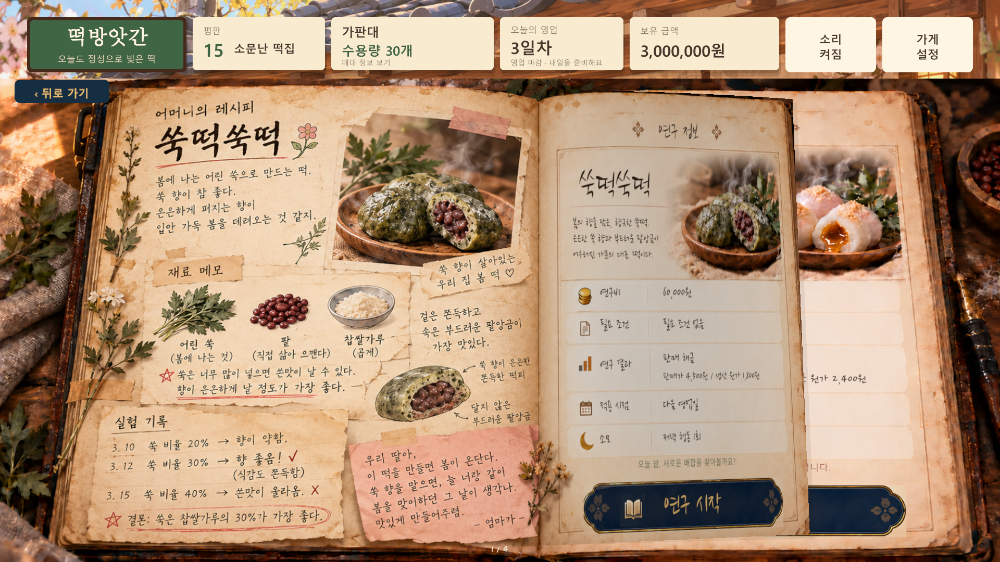
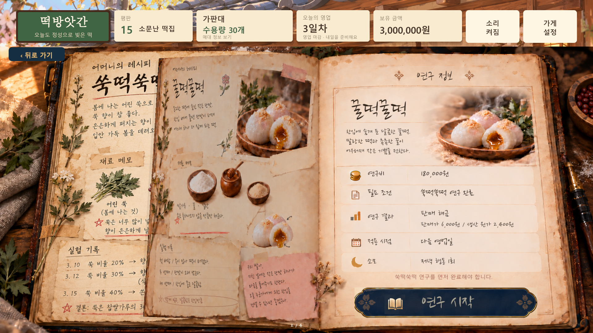
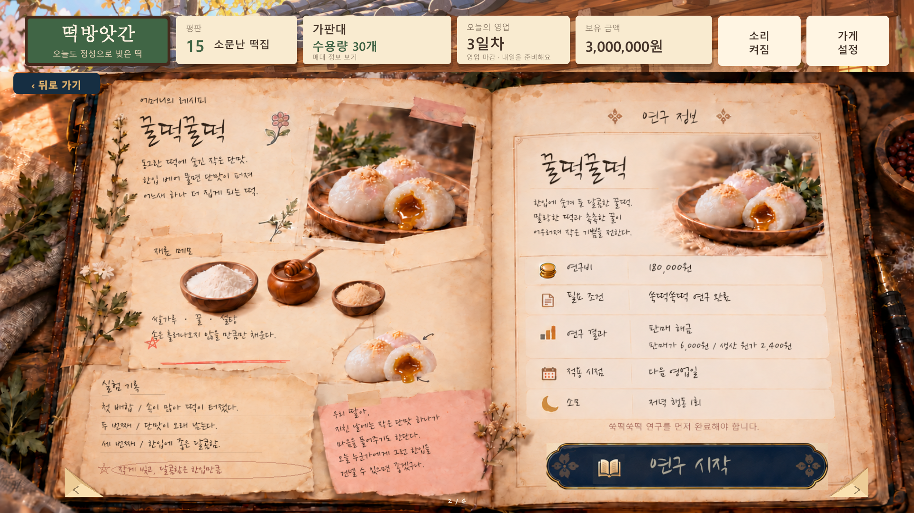
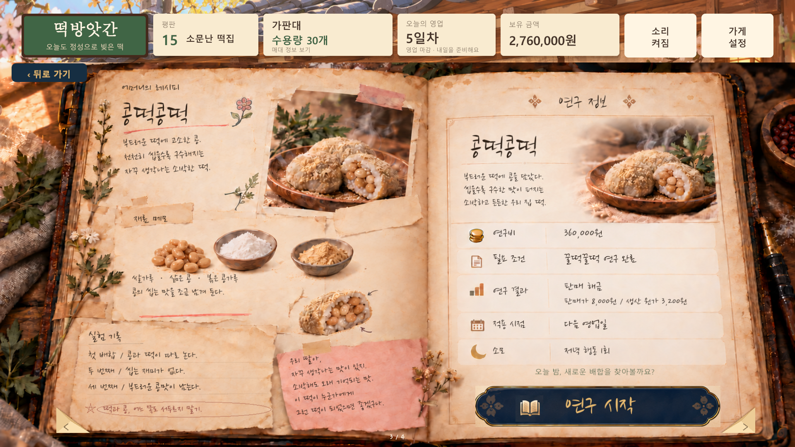
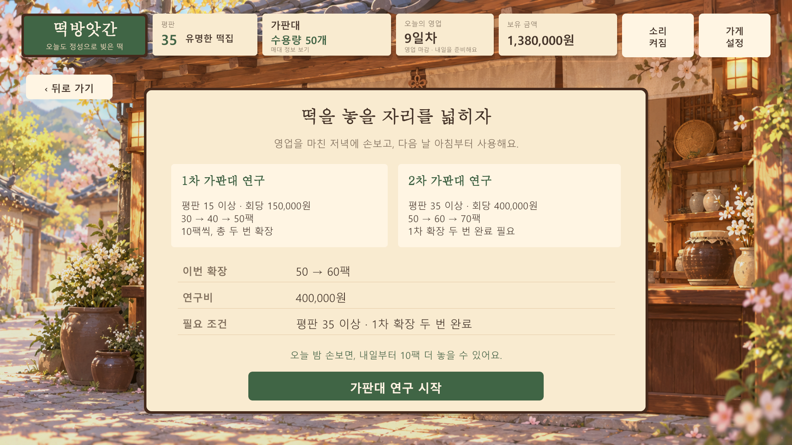
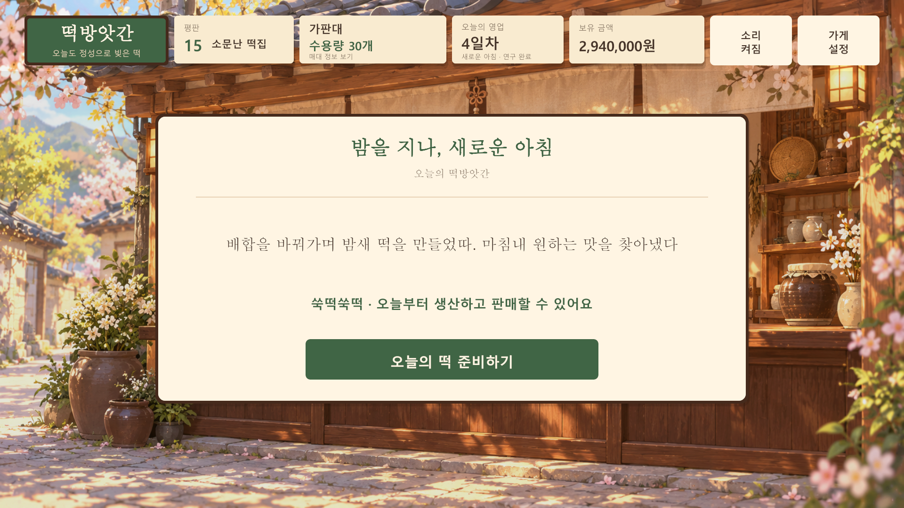

# 검증 기록

공통 API 변경 검증 날짜: 2026-10-07. Unity **6000.3.25f1 (e1dba0a9aba4)**. Windows 64비트 개발용 실행 파일 빌드 성공, 종료 코드 0. AI 호출 등의 이전 기록은 각 원본 체크 목록을 유지합니다.

## 게임 규칙과 저장

Unity 에디터의 `DdukDduk.Shop.Editor.ShopModelVerification.RunAll()`에서 **60개 검증이 통과**했습니다. 실제 Unity JsonUtility를 사용해 저장 형식 버전 5와 이전 버전 복원을 검사했습니다.

`ShopCommonApiVerification.RunAll()`의 **26개 검증**도 통과했습니다. 설계표의 17개 공개 함수와 자료형·private 데이터, 단계 전환, 금액·평판 오버플로 무변경, 연구 ID 순서·중복 등록·익일 적용, ID별 마케팅 및 7→8일 주간 경계, 호감도와 저장 격리, 버전 4→5 연구 복원을 검사했습니다. 잘못된 공통 저장 17가지가 상태를 바꾸지 않는지, 변경 이벤트 순간에도 예약·차감·아침 완료를 유효한 JSON으로 저장할 수 있는지 확인했습니다.

기본 수량 한도, 단일·혼합·빈 배치, 음수·초과 입력, 자동 배치, 평판 경계와 판매율, 정수 판매량 배분, 매출·생산비, 중복 생산·판매·추천 보상 방지, 0개 배치 추천 금지와 다음 날 초기화를 검증했습니다.

새 저녁 흐름은 연구 여부·종류·상세·휴식 확인·뒤로 가기, 연구 순서와 비용, 자금·평판 조건, 한 저녁의 중복 신청 금지, 확정 시 한 번 차감과 다음 날 해금·확장을 검사했습니다. 30→40→50→60→70팩의 네 단계, 70팩 이후 추가 구매 금지, 두 종류의 정확한 아침 문구와 확인 전 생산 차단을 포함합니다. 유료 예약 중 저장·복원, 아침 안내 복원, 잘못된 연구 예약 거부와 기존 버전의 진행 보존도 확인했습니다.

보유금 반영 시점도 검사했습니다. 배치 완료·손님 등장·추천 피드백에서는 보유금을 유지하고, 판매 결과 단계에 들어갈 때 판매 수익에서 생산비를 뺀 순이익을 한 번 반영합니다. 성공 추천, 실패 추천의 손실, 빈 배치의 0원 정산, 결과 알림 시점과 중복 정산 방지를 포함합니다.

저장 버전 5는 공통 데이터와 기존 정산 완료 여부를 보존합니다. 미정산 상태를 저장·복원한 뒤 결과 단계에서 한 번 정산하고, 이미 정산된 결과를 복원하면 다시 입금하지 않습니다. 이전 버전 1~3의 저장은 당시 이미 반영된 보유금을 유지하도록 이관합니다. 특히 버전 3의 손님 등장·추천 대기·피드백·결과 저장을 각각 복원해 기존 판매금이 중복 반영되지 않는 것을 확인했습니다. 잘못된 정산 표시의 저장은 현재 상태를 바꾸지 않고 거부합니다.

## 실제 게임 화면과 진행

저장된 씬을 플레이 모드로 재생하기 전에 다시 열어 **689개 구성 검사**를 통과했습니다. 비활성 UI를 포함한 모든 `Graphic`에서 지연 생성 접근자 대신 `GetComponent<CanvasRenderer>()`로 실제 부품이 존재하는지 확인합니다. 좌우 모서리 두 개와 종이·그림자 두 개는 각각 렌더러 하나를 저장하며, 비활성 오브젝트에 커스텀 그래픽을 추가해도 렌더러가 함께 생성됩니다. 모서리 활성화와 화면 범위를 검사하고 임시 상태를 저장하지 않고 원래 씬을 다시 엽니다. 배치 에디터에서는 모서리 렌더 깊이가 없으므로 클릭 적중 여부는 아래 실행 파일 검증에서 확인합니다. 상세 기록은 `Docs/Verification/canvas-renderer-build-summary.txt`입니다.

Windows 플레이어의 `-shopNoSave -shopFakeDialogue -shopCaptureDir <출력폴더>` 검증에서 **458개 항목이 통과**, 종료 코드 0입니다. 테스트용 자금·평판을 준비해 오래 수익을 모으지 않고 모든 유료 단계를 확인했으며, 실제 사용자 버튼으로 진행했습니다. 원본 체크 목록은 `Docs/Verification/ui-checks.txt`입니다.

- 배치 완료 → 판매 시작 → 손님 요구사항 → 추천 성공·실패 → 리절트 → 저녁 연구 선택.
- 배치 완료·손님 등장·추천 피드백까지 보유금과 상단 금액 유지, 결과 창 표시와 함께 순이익 반영.
- 성공·실패·빈 배치의 정산, 반복 화면 갱신·저녁 이동·다음 날에서 중복 입금 방지.
- 결과 단계에서 `view.Bind(model)`을 다시 호출해 화면 초기화·저장 재개 경로에서도 결과 창과 정산 상태, 보유금 표시가 유지되는 것 확인.
- 리절트 7초 뒤 자동으로 연구 여부 화면 이동, 수동 대기 건너뛰기.
- 0개 배치 추천 금지, 추천할 떡이 없는 날의 응대 마무리.
- 연구 종류·두 상세 화면·비용 확인·휴식 확인의 모든 뒤로 가기에서 비용과 상태 유지.
- 네 장의 책 미리 보기·책장 넘김·선행 연구 잠금·비용 부족 표시.
- 네 가지 떡의 순차 연구와 60,000 / 180,000 / 360,000 / 720,000원 차감.
- 가판대 1차 회당 150,000원 두 번, 2차 회당 400,000원 두 번, 평판 15 / 35 조건과 최대 70팩.
- 비용 차감 이벤트 순간에는 그날 해금·한도가 그대로이며, 다음 날에만 변경되는 것 확인.
- 요청한 아침 완료 문구, 확인 전 생산 차단, 확인 후 새 떡·한도 사용.

숨긴 검증 창에서도 동일한 Canvas를 Unity 카메라의 RenderTexture에 렌더링했습니다. 비어 있지 않은 PNG를 검사하고 1920×1080과 1280×800에서 실제 글자·버튼·그림·잠금 상태를 확인했습니다. 연구소는 사용자가 제시한 펼쳐진 책 구성을 반영해 왼쪽 레시피·재료·실험 기록과 오른쪽 연구 정보·비용·시작 버튼을 표시합니다. 네 레시피의 내용과 가격, 선행 조건을 전환하고, 종이가 접히며 넘어가는 중간 장면도 캡처했습니다. 별도 비용 확인 창과 뒤로 가기, 완료된 연구의 재구매 금지도 검사했습니다.

책장 넘김은 현재·다음 페이지의 실제 렌더링을 양면 종이에 사용합니다. 글씨와 사진을 함께 넘기고, 책의 비스듬한 윗모서리에 맞춘 윤곽과 접힌 부분의 그림자를 표시합니다. 큰 네모 이동 버튼 네 개는 제거하고, 양쪽 아래 종이 모서리 두 개로 바꿨습니다. 뒤로 가기와 페이지 번호는 종이에 복사하지 않습니다. 양방향 각각 진행률 18·35·50·65·82%의 열 장면을 캡처하고, 메쉬 좌표·삼각형과 모서리 클릭을 검사했습니다. 연속 입력 차단, 처음·마지막 장 경계, 넘김 초반·후반에 뒤로 가기, 재진입과 임시 텍스처 해제를 확인했습니다. 책을 읽거나 넘김을 취소해도 보유금·평판·영업일·가판대·연구 상태가 유지됩니다. 기록은 `Docs/Preview/BookTurn`과 `Docs/Verification/recipe-turn-build-summary.txt`에 있습니다.

레시피 화면의 꿀떡·콩떡 재료 메모에서 작은 쑥 묶음을 제거하고 남은 세 가지 재료를 중앙에 맞췄습니다. 쑥떡 왼쪽 원본 손글씨는 유지하며, 다른 페이지의 제목·본문은 동봉된 붓·펜 손글씨로 표시합니다. 실험 기록은 문장 세 줄에 맞춰 개별 밑줄을 그리고 결론 타원을 글씨와 맞췄습니다. 연구 버튼은 아래로 28px 옮겨 안내 문구와 24px 간격을 두고, 책 아이콘과 버튼 문구를 왼쪽으로 옮겼습니다. 별도 버튼 그림을 사용해 이전 위치에 버튼이 중복으로 남지 않습니다. 빨간 선행 조건 안내, 초록 연구 안내 및 연구 완료 문구를 1920×1080과 1280×800 캡처에서 확인했습니다.

## 동봉된 AI의 실제 게임 호출

`-shopNoSave -shopRequireAi -shopCaptureDir <출력폴더>`로 실제 로컬 AI를 호출해 **79개 검증 통과**, 종료 코드 0입니다. 원본 체크 목록은 `Docs/Verification/ai-checks.txt`입니다. 기본 대사를 AI 성공으로 계산하지 않고 담백·달콤·고소 각각 `GeneratedWithAi == true`와 비어 있지 않은 응답을 확인했습니다.

세 맛 모두 동봉된 모델로 생성 → 해당 떡 추천 성공 → 평판 +1 → 리절트 → 저녁 연구 여부 → 휴식 확인 → 다음 날 초기화까지 진행했습니다. 각 맛에서 손님 등장·추천 피드백 동안 보유금을 유지하고 결과 창에서만 정산하는 것을 모델 값과 상단 표시로 확인했습니다. 반복 갱신과 다음 날 이동에서도 추가 입금이 없었습니다. 개발용 외부 서버·계정·API 키를 사용하지 않았습니다.

최종 체크 목록과 대사 원본은 [Docs/Verification](Docs/Verification)에 있습니다. 작은 모델에서는 어색한 문장이나 역할 혼동이 나올 수 있습니다. 사용자가 요청한 대로 비어 있지 않은 문장은 그대로 표시하므로 항상 자연스럽거나 매번 고유한 대사는 보장하지 않습니다. 생성 실패나 빈 응답이면 기본 대사를 표시합니다.

## 다른 Windows PC용 구성

공식 Qwen3-0.6B Q8_0 모델 SHA256을 확인했습니다. llama.cpp CPU 엔진과 변경 없는 release CRT DLL을 포함했습니다. 이전 네이티브 모듈 검증에서 CRT가 동봉된 폴더에서 로드되었고 외부 의존성은 Windows OS 라이브러리로 확인했습니다. 별도의 깨끗한 PC 실물 테스트는 수행하지 않았습니다.

배포 시 실행 파일 하나 대신 빌드 폴더 전체를 전달합니다. 다른 OS용 엔진은 아직 포함하지 않았습니다. 준비·라이선스·용량·배포 설명은 [LOCAL_AI.md](LOCAL_AI.md)에 있습니다.

## 현재 범위

생산은 즉시 완료되며 생산 시간·생산 애니메이션, 운영비·임대료를 포함한 전체 정산과 재고 이월은 아직 없습니다. 표시 순이익은 판매 수익에서 생산비를 뺀 값이며 판매 결과 단계에서 보유금에 반영됩니다. 별도 연구비는 연구 시작 확정 시 차감됩니다. 궁떡궁떡은 사용자가 맛을 지정하지 않아 추천 대상에서 제외합니다. 연구와 가판대 비용·조건, 레시피 내용은 소스에서 수정할 수 있습니다.

